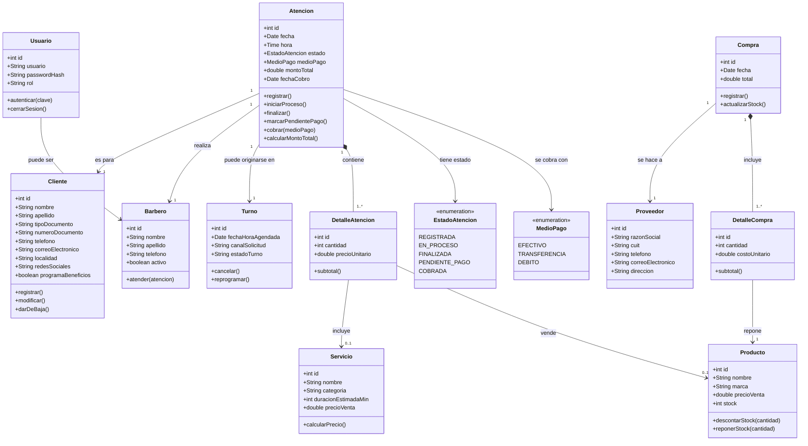
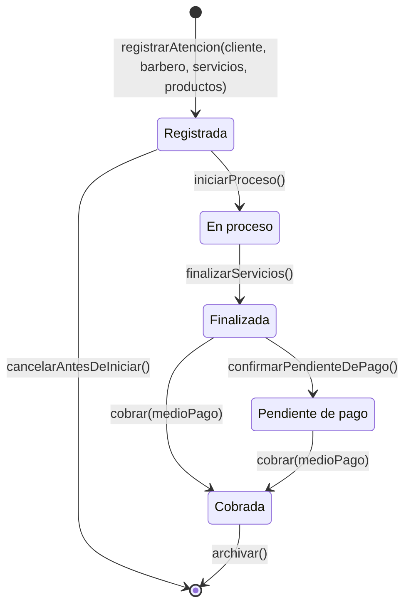

# 03 · Modelado UML — transacción principal: "Atención"

Los 5 diagramas modelan la **transacción principal del sistema: la Atención** (atención al cliente), su ciclo de vida y los elementos esenciales y de soporte (MODP — Modelo de Objetos del Dominio del Problema).

## 1. Diagrama de Clases (MODP)

**Herramienta**: StarUML 7 · **Imagen**: [`uml/class-diagram.png`](uml/class-diagram.png) · **Fuente**: [`uml/class-diagram.mmd`](uml/class-diagram.mmd)

Clases esenciales: `Atencion`, `DetalleAtencion`, `Cliente`, `Barbero`, `Servicio`, `Producto`.
Clases de soporte: `Turno`, `Usuario`, `Proveedor`, `Compra`, `DetalleCompra`, y las enumeraciones `EstadoAtencion` y `MedioPago`.

Relaciones clave:
- `Atencion` 1–1 con `Cliente` y `Barbero`; composición 1–\* con `DetalleAtencion`.
- Cada `DetalleAtencion` incluye **un** Servicio **o** vende **un** Producto (0..1 en cada rol).
- `Atencion` se origina opcionalmente en un `Turno`.
- `Compra` (composición con `DetalleCompra`) repone `Producto` y se realiza a un `Proveedor`.

## 2. Diagrama de Estados — Atención

**Herramienta**: StarUML 7 · **Imagen**: [`uml/state-diagram.png`](uml/state-diagram.png) · **Fuente**: [`uml/state-diagram.mmd`](uml/state-diagram.mmd)

Ciclo de vida según el enunciado: **Registrada → En proceso → Finalizada → Pendiente de pago → Cobrada**.

## 3. Diagrama de Casos de Uso

**Herramienta**: Excalidraw · **Online**: https://excalidraw.com/#json=BaQGcGb1mVHyUwXA7q2Q4,kEX-ziXGvICs-rdzwJWiVQ

Actores: **Cliente**, **Barbero** y **Administrador**. Foco en la interacción del usuario con la transacción principal:

- *Barbero*: **Registrar atención** (RF03/RF04) → `<<include>>` **Cambiar estado** (RF04) y **Cobrar atención** (RF05).
- *Cliente*: Iniciar sesión, Solicitar turno, Cobrar (paga).
- *Administrador*: Registrar cliente, Gestionar catálogo, Comprar insumos.

## 4. Diagrama de Componentes

**Herramienta**: Excalidraw · **Online**: https://excalidraw.com/#json=s7GNhStrsbzY6PEgm9Y2F,6ig5CftAw9FlRQKcFtYaSQ

Arquitectura en capas de la SPA:
1. **Presentación**: Login UI, Clientes UI, Turnos UI, Atenciones UI, Catálogo UI (HTML + Bootstrap 5).
2. **Lógica**: controladores JavaScript por dominio (`AuthController`, `ClientesController`, `TurnosController`, `AtencionesController`, `CatalogoController`). `AtencionesController` es el componente de la transacción principal.
3. **Acceso a datos**: `StorageService` — única puerta hacia la persistencia (abstracción para migrar a backend futuro, RNF08).
4. **Datos**: `localStorage` del navegador (JSON).

## 5. Diagrama de Despliegue

**Herramienta**: Excalidraw · **Online**: https://excalidraw.com/#json=s7GNhStrsbzY6PEgm9Y2F,6ig5CftAw9FlRQKcFtYaSQ

- `«device»` Navegador del usuario: ejecuta la SPA + `localStorage`.
- `«execution environment»` **GitHub Pages**: sirve la app estática por HTTPS.
- `«node»` **GitHub Actions (CI/CD)**: valida (lint/build) en cada push y despliega a Pages (RNF06).
- `«artifact»` **Repositorio GitHub** (`main`): código fuente que dispara el pipeline.
