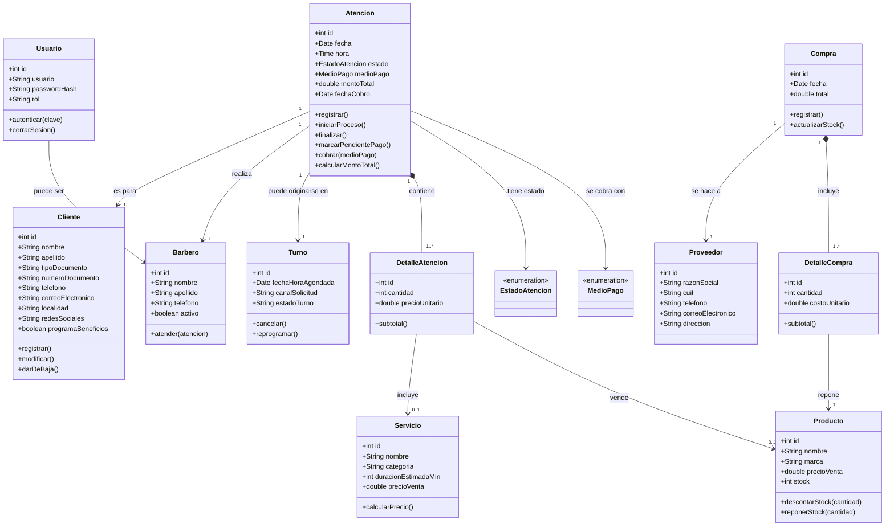
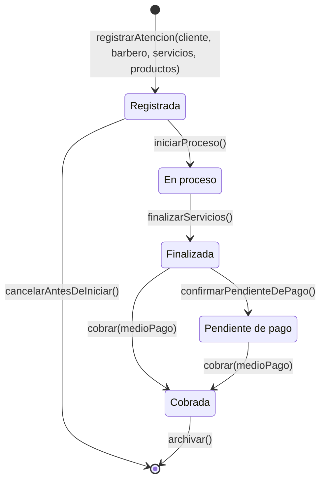

# 03 · Modelado UML — transacción principal: "Atención"

Los 5 diagramas modelan la **transacción principal del sistema: la Atención** (atención al cliente), su ciclo de vida y los elementos esenciales y de soporte.

## 1. Diagrama de Clases (MODP)

**Herramienta**: StarUML 7 · **Imagen**: [`uml/class-diagram.png`](uml/class-diagram.png) · **Fuente**: [`uml/class-diagram.mmd`](uml/class-diagram.mmd)

Clases esenciales: `Atencion`, `DetalleAtencion`, `Cliente`, `Barbero`, `Servicio`, `Producto`.
Clases de soporte: `Turno`, `Usuario`, `Proveedor`, `Compra`, `DetalleCompra`, y las enumeraciones `EstadoAtencion` y `MedioPago`.

Las enumeraciones **no fijan valores en el modelo**: los estados de la `Atencion` se describen en el diagrama de estados (sección 2) y los medios de pago se gestionan como datos de la aplicación, ya que pueden cambiar en el futuro.

Justificación del diseño (observaciones de cátedra, 27/10):
- El modelo de clases es **de estructura**: no listetypes tipos de servicio ni estados como clases o literales; esos valores pertenecen al diagrama de estados y a los datos (catálogo) del sistema.
- Se validan **dos transacciones**: `Atencion` (el negocio presta el servicio al cliente, e incluye la venta de productos a través de `DetalleAtencion` → `Producto`) y `Compra` (el negocio compra a un proveedor externo; mediante `DetalleCompra` repone `Producto`).
- La venta de un producto está incorporada a la atención: no existe una transacción aparte de "venta".

Relaciones clave:
- `Atencion` 1–1 con `Cliente` y `Barbero`; composición 1–\* con `DetalleAtencion`.
- Cada `DetalleAtencion` incluye **un** Servicio **o** vende **un** Producto (0..1 en cada rol).
- `Atencion` se origina opcionalmente en un `Turno`.
- `Compra` (composición con `DetalleCompra`) repone `Producto` y se realiza a un `Proveedor`.



## 2. Diagrama de Estados — Atención

**Herramienta**: StarUML 7 · **Imagen**: [`uml/state-diagram.png`](uml/state-diagram.png) · **Fuente**: [`uml/state-diagram.mmd`](uml/state-diagram.mmd)

Ciclo de vida según el enunciado: **Registrada → En proceso → Finalizada → Pendiente de pago → Cobrada**.



## 3. Diagrama de Casos de Uso

**Herramienta**: Mermaid (`usecase-beta`) · **Imagen**: [`uml/use-case.png`](uml/use-case.png) · **Fuente**: [`uml/use-case.mmd`](uml/use-case.mmd)

Actores: **Barbero** y **Administrador** — ambos acceden al sistema. El **Cliente** no accede a la app: solicita turnos de manera presencial o digital vía WhatsApp (RF02) y los gestiones las registra el barbero. Foco en la interacción con la transacción principal:

- *Barbero*: Iniciar sesión, **Solicitar turno** (RF02), **Registrar atención** (RF03/RF04) y **Cobrar atención** (RF05).
- *Administrador*: Iniciar sesión, **Registrar cliente**, **Gestionar catálogo** y **Comprar insumos**.

Actor textual (formato `usecase-beta`):

```mermaid
usecase-beta
direction LR
actor Barbero("Barbero")
actor Administrador("Administrador")

systemBoundary "Estilo Córdoba"
  IniciarSesion("Iniciar sesión")
  SolicitarTurno("Solicitar turno")
  RegistrarCliente("Registrar cliente")
  GestionarCatalogo("Gestionar catálogo")
  ComprarInsumos("Comprar insumos")
  RegistrarAtencion("Registrar atención")
  CobrarAtencion("Cobrar atención")
end

Barbero --> IniciarSesion
Barbero --> SolicitarTurno
Barbero --> RegistrarAtencion
Barbero --> CobrarAtencion
Administrador --> IniciarSesion
Administrador --> RegistrarCliente
Administrador --> GestionarCatalogo
Administrador --> ComprarInsumos
```

## 4. Diagrama de Componentes

**Imágenes**: [`uml/components-deployment.png`](uml/components-deployment.png) · **Archivo editable**: [`uml/componentes-despliegue.excalidraw`](uml/componentes-despliegue.excalidraw) (se abre en excalidraw.com → File → Open)
https://excalidraw.com/#json=p0evWtdkZ2UVvPCIHbEuZ,qsQEZygyoDWx2jmWCw0yOA
Arquitectura en capas de la SPA:
1. **Presentación**: Login UI, Clientes UI, Turnos UI, Atenciones UI, Catálogo UI (HTML + Bootstrap 5).
2. **Lógica**: controladores JavaScript por dominio (`AuthController`, `ClientesController`, `TurnosController`, `AtencionesController`, `CatalogoController`). `AtencionesController` es el componente de la transacción principal.
3. **Acceso a datos**: `StorageService` — única puerta hacia la persistencia (abstracción para migrar a backend futuro, RNF08).
4. **Datos**: `localStorage` del navegador (JSON).

## 5. Diagrama de Despliegue

**Imágenes**: [`uml/components-deployment.png`](uml/components-deployment.png) · **Archivo editable**: [`uml/componentes-despliegue.excalidraw`](uml/componentes-despliegue.excalidraw) (se abre en excalidraw.com → File → Open)
https://excalidraw.com/#json=p0evWtdkZ2UVvPCIHbEuZ,qsQEZygyoDWx2jmWCw0yOA
- `«device»` Navegador del usuario: ejecuta la SPA + `localStorage`.
- `«execution environment»` **GitHub Pages**: sirve la app estática por HTTPS.
- `«node»` **GitHub Actions (CI/CD)**: valida (lint/build) en cada push y despliega a Pages (RNF06).
- `«artifact»` **Repositorio GitHub** (`main`): código fuente que dispara el pipeline.
